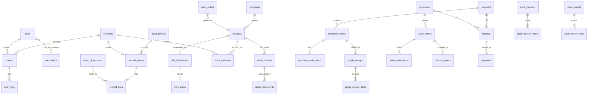

# Architecture

## Layers

```
Router (FastAPI)  ->  Service (business rules)  ->  SQLAlchemy session / models
   auth, RBAC,           ledger, inventory,           constraints, indexes,
   validation,           procurement, sales,          immutability guards
   audit trail           reports, dashboard
```

- **Routers** (`backend/app/routers`) authenticate, authorise (`require("permission")`), validate input with Pydantic, call a service, write the audit row and commit.
- **Services** (`backend/app/services`) hold all business rules and never commit. They only `flush`, so a document and its journal entry commit or roll back together.
- **Models** (`backend/app/models`) declare 36 tables with `CHECK`, `UNIQUE`, foreign-key and composite-index constraints.
- Database access goes through SQLAlchemy sessions injected with `Depends(get_db)`. The session acts as the unit of work; a separate repository layer was not added because services query the ORM directly and a thin wrapper would only forward calls.

## Key design decisions

| Decision | Reason |
| --- | --- |
| Money `Numeric(18,2)`, quantity and unit cost `Numeric(18,4)` | No float rounding in totals. Unit costs keep four decimals so assembly costs do not drift. |
| Services only flush; routers commit | Atomic business documents plus journals. |
| `before_flush` guards on `journal_lines`, `stock_movements`, `audit_logs` | Append-only data cannot be edited or deleted through the ORM. Posted journal entries may only change status to `REVERSED`. |
| Guarded `UPDATE ... WHERE on_hand - reserved >= :qty` | Overselling is impossible even with concurrent requests, on SQLite and PostgreSQL. |
| `document_sequences` row updated with a single statement | Concurrency-safe numbering (`PO-2026-000012`). |
| Refresh tokens stored server-side by `jti` and `family` | Rotation on every refresh; replaying an old token revokes the whole family. |
| Dashboard `as_of` defaults to the latest journal date | The demo data stays meaningful whenever it is opened. |

## Posting rules

| Event | Debit | Credit |
| --- | --- | --- |
| Goods receipt | 1300 / 1310 Inventory | 2200 Goods received not billed |
| Vendor bill | 2200 | 2100 Accounts payable |
| Supplier payment | 2100 | 1100 Cash and bank |
| Assembly completed | 1300 Finished goods | 1310 Raw materials (actual FIFO cost) |
| Delivery | 5100 COGS | 1300 / 1310 Inventory |
| Customer invoice | 1200 Accounts receivable | 4100 Sales revenue |
| Customer payment | 1100 | 1200 |
| Stock shortage | 6900 Inventory loss | Inventory |
| Stock overage | Inventory | 4200 Inventory gain |

## ERD (core)



Tables beyond the 28 in the brief: `role_permissions`, `refresh_tokens`, `document_sequences`, `goods_receipt_items`, `stock_transfers`, `stock_transfer_items`, `stock_counts`, `stock_count_items`.

## SQLite and PostgreSQL

Set `DATABASE_URL` in `.env`. Column types, constraints and indexes are portable. SQLite stores `NUMERIC` as binary floating point, so every value is re-quantised to 2 or 4 decimals when read and extended amounts are rounded in services; PostgreSQL stores exact decimals. Row locks (`SELECT ... FOR UPDATE`) are emitted and ignored by SQLite, which serialises writers instead.
